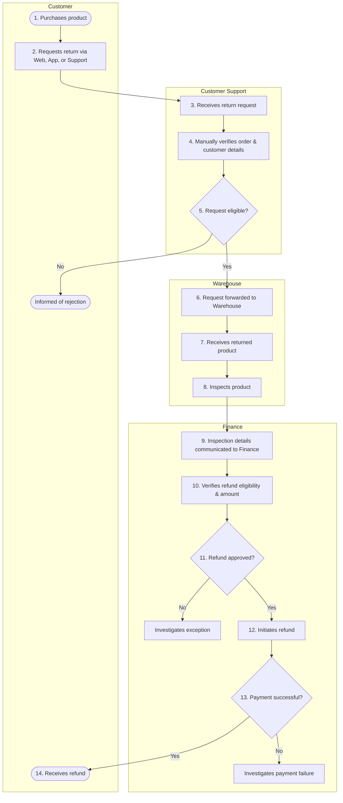
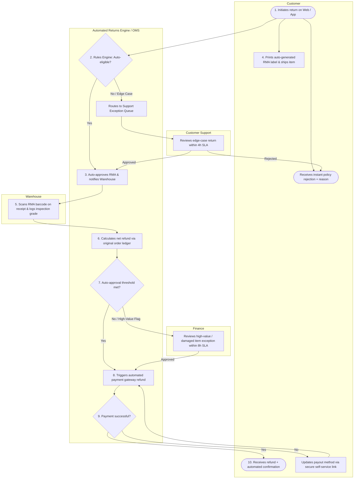

# 📦 E-Commerce Returns & Refunds Optimization — Business Analysis Case Study


> **Executive Summary:** An online retailer experiencing high customer churn and rising support ticket volume due to **9-day average refund turnaround times** needed an end-to-end operational redesign. By mapping the cross-functional **As-Is workflow** (Customer, Support, Warehouse, Finance), isolating manual verification and duplicate-approval bottlenecks, and designing an event-driven **To-Be Returns Engine**, internal handling time is projected to drop by **~85%** (from 6.0 business days to < 16 hours) while achieving **80%+ straight-through processing (STP)**.

---

## 📑 Table of Contents
1. [Problem Statement & Business Context](#-1-problem-statement--business-context)
2. [Transaction Data & Root-Cause Investigation](#-2-transaction-data--root-cause-investigation)
3. [AS-IS Process Map & Bottleneck Analysis](#-3-as-is-process-map--bottleneck-analysis)
4. [TO-BE Process Map & System Handoffs](#-4-to-be-process-map--system-handoffs)
5. [Business Requirements Document (BRD)](#-5-business-requirements-document-brd)
6. [Business Case & Cycle-Time Impact](#-6-business-case--cycle-time-impact)
7. [Repository Structure](#-7-repository-structure)

---

## 🎯 1. Problem Statement & Business Context

Customers can initiate product returns through multiple channels (**Website, Mobile App, or Customer Support**), while backend execution is fragmented across **Customer Support**, **Warehouse Operations**, and **Finance**. 

Because teams operate in disconnected queues without automated business rules or event triggers:
* Customers face an average **9.0-business-day** wait for refunds.
* *"Where is my refund?" (WISMR)* inquiries inflate Customer Support workload.
* Both Support and Finance perform redundant eligibility checks, delaying payouts and creating inconsistent policy enforcement.

**Project Goal:** Diagnose operational delays using transaction/log patterns, redesign the workflow for automated straight-through processing, document functional and non-functional requirements in a formal BRD, and quantify time/labor savings.

---

## 🔍 2. Transaction Data & Root-Cause Investigation

To validate operational assumptions before redesigning the workflow, historical order, CRM, Warehouse Management System (WMS), and payment gateway logs are evaluated across four diagnostic dimensions:

| Diagnostic Lens | Metrics & Data Fields Analyzed | Operational Hypothesis Tested |
| :--- | :--- | :--- |
| **Channel Intake Lag** | `channel_type` (Web/App vs. Support), `request_created_at`, `rma_issued_at` | Self-service requests sit in the same manual Support triage queue as phone/chat tickets, nullifying self-service speed. |
| **Stage-by-Stage Dwell Time** | Timestamps across Intake, Dock Receipt, Inspection, Finance Review, and Gateway Settlement | Internal handoff queues between departments consume >60% of total cycle time (excluding physical carrier transit). |
| **Return Reason & SKU Risk** | `return_reason_code`, `sku_category`, `order_value`, `customer_return_rate` | Low-value, non-defective standard returns undergo the exact same manual scrutiny as high-value or damaged claims. |
| **Exception & Failure Loops** | `rejection_rate`, `finance_exception_flag`, `gateway_error_code` | Failed bank/card payouts stall in Finance queues without automated customer self-service recovery links. |

---

## 🔴 3. AS-IS Process Map & Bottleneck Analysis

### Current-State Swimlane Workflow


### Key Bottlenecks Identified
1. **Manual Intake Verification (Step 4):** Support agents manually verify order dates, return windows, and SKU eligibility—adding **24–48 hours** of queue lag to routine returns.
2. **Duplicate Eligibility Gateways (Steps 5 & 10):** Both Customer Support and Finance independently verify "eligibility," creating redundant labor and policy discrepancies.
3. **Unstructured Inter-Team Handoffs (Steps 6 & 9):** Forwarding requests to Warehouse and sharing inspection notes with Finance rely on manual ticket updates/emails rather than real-time system events.
4. **Dead-End Exception Handling (Steps 11 & 13):** Refund exceptions and failed gateway payouts drop into open-ended Finance investigation queues with no defined SLAs or customer self-service resolution paths.

---

## 🟢 4. TO-BE Process Map & System Handoffs

### Future-State Automated Workflow
The redesigned workflow introduces a centralized **Order Management & Returns Engine (OMS)** that automates policy validation, RMA label generation, ledger refund calculation, and payment gateway execution—restricting human intervention strictly to high-risk or damaged exceptions.



### Inter-Team Data Handoff Matrix

| Handoff Path | Data Payload Transferred | Automation Trigger |
| :--- | :--- | :--- |
| **Customer $\rightarrow$ OMS** | `Order_ID`, `SKU_ID`, `Return_Reason`, `Photo_Evidence` | Real-time API on return submission |
| **OMS $\rightarrow$ Warehouse** | `RMA_ID`, `Expected_SKUs`, `Condition_Expectation`, `Tracking_ID` | Instant webhook upon RMA approval |
| **Warehouse $\rightarrow$ OMS** | `RMA_ID`, `Received_Timestamp`, `Inspection_Grade` (`A` / `B` / `F`) | Handheld barcode scan in WMS |
| **OMS $\rightarrow$ Payment Gateway** | `Refund_Amount`, `Original_Payment_Token`, `Idempotency_Key` | Event trigger upon `Inspection_Grade = A/B` |

---

## 📋 5. Business Requirements Document (BRD)

### 5.1 Business Objectives & Success KPIs
* **Cycle Time Reduction:** Cut internal refund handling time (excluding carrier transit) from **6.0 business days** to **< 16 hours**.
* **Straight-Through Processing (STP):** Automate **$\ge$ 80%** of standard return requests end-to-end without Support or Finance touchpoints.
* **Ticket Deflection:** Reduce WISMR (*"Where is my refund?"*) support contacts by **60%** via proactive milestone alerts.

### 5.2 Scope
* **In-Scope:** Automated eligibility rules engine, instant RMA & shipping label generation, WMS-to-OMS barcode inspection sync, automated ledger refund calculation, payment gateway API integration, self-service failed-payout recovery.
* **Out-of-Scope:** Third-party logistics (3PL) carrier transit optimization, brick-and-mortar store returns, marketplace drop-ship vendor returns.

### 5.3 Functional Requirements

| ID | Requirement | Specification | Priority |
| :--- | :--- | :--- | :--- |
| **FR-01** | **Automated Eligibility Rules Engine** | Validate return window ($\le$ 30 days post-delivery), SKU returnability flags, and account abuse thresholds in real time upon request submission. | **Must Have** |
| **FR-02** | **Instant RMA & Label Generation** | Generate a unique `RMA_ID`, printable barcode return label, and inbound pre-alert in WMS immediately upon FR-01 approval. | **Must Have** |
| **FR-03** | **Standardized WMS Inspection Codes** | Require Warehouse staff to scan the RMA barcode and select structured disposition codes (`Grade A: Resellable`, `Grade B: Open Box`, `Grade F: Damaged/Mismatch`). | **Must Have** |
| **FR-04** | **Automated Refund Ledger Calculation** | Automatically calculate net refund (item price + prorated tax minus applicable return shipping/restocking fees) from the original order ledger upon `Grade A/B` scan. | **Must Have** |
| **FR-05** | **Threshold-Based Finance Governance** | Route refunds exceeding configurable thresholds (e.g., `> ₹15,000` / `$200`) or `Grade F` inspections to a Finance Exception Queue with an 8-hour SLA. | **Should Have** |
| **FR-06** | **Automated Payment Failure Recovery** | On gateway payout failure (expired card/closed account), trigger an automated email/SMS with a secure link allowing the customer to choose store credit or an alternate bank/UPI account. | **Must Have** |
| **FR-07** | **Event-Driven Status Notifications** | Send automated customer notifications at 4 lifecycle events: *RMA Approved*, *Item Received at Warehouse*, *Refund Initiated*, and *Refund Settled*. | **Should Have** |

### 5.4 Non-Functional Requirements
* **Latency:** Eligibility rules evaluation (`FR-01`) must complete in **< 1.5 seconds**.
* **Financial Idempotency:** Payment gateway refund calls must enforce strict idempotency keys (`RMA_ID + Attempt_ID`) to prevent duplicate disbursements.
* **Auditability:** All rule evaluations, WMS inspection scans, and manual exception overrides must maintain immutable audit logs (`User/System_ID`, `Timestamp`, `Reason_Code`).
* **Availability:** Returns portal and OMS webhook listeners must maintain **99.9% uptime**.

### 5.5 Risks & Mitigations
* **Return Fraud / Empty-Box Claims:** *Mitigation:* Funds are never released upon RMA creation; disbursement triggers strictly after physical WMS dock receipt and weight/grade verification (`FR-03`).
* **WMS-to-OMS Sync Failures:** *Mitigation:* Implement asynchronous event queues with automated retries and a 15-minute batch reconciliation job.

---

## 📈 6. Business Case & Cycle-Time Impact

### Baseline Model Assumptions
* **Monthly Return Volume:** `10,000 returns/month`
* **Target Automation Rate (STP):** `80%` (`8,000 returns/month` processed touchlessly)
* **Carrier Reverse Transit:** Fixed at `3.0 business days` (`72 hours`) across both states to isolate internal operational gains.

### Processing Time Comparison (Per Return)

| Stage | AS-IS Duration | TO-BE Duration | Time Saved | Key Improvement Driver |
| :--- | :---: | :---: | :---: | :--- |
| **1. Request $\rightarrow$ RMA Approval** | 36 hrs *(1.5 days)* | **< 2 mins** *(80% STP)*<br>4 hrs *(20% edge cases)* | **~35 hrs** | Rules engine eliminates manual Support order lookup |
| **2. Reverse Carrier Transit** | 72 hrs *(3.0 days)* | 72 hrs *(3.0 days)* | 0 hrs | External carrier transit unchanged |
| **3. Inspection $\rightarrow$ Finance Review** | 36 hrs *(1.5 days)* | **< 5 mins** *(webhook sync)* | **~36 hrs** | WMS barcode scan triggers OMS calculation immediately |
| **4. Finance Review $\rightarrow$ Payout Init.** | 24 hrs *(1.0 day)* | **< 10 mins** *(auto-payout)* | **~24 hrs** | Eliminates duplicate eligibility check & batch queues |
| **5. Bank / Gateway Settlement** | 48 hrs *(2.0 days)* | 24–48 hrs *(1–2 days)* | **~12 hrs** | Instant API payout + automated payment-failure recovery |
| **Total End-to-End Turnaround** | **9.0 Business Days** | **~4.2 Business Days** | **~4.8 Days (-53%)** | **Internal handling time drops from 6.0 days to < 16 hrs (-85%)** |

### Operational Capacity Reclaimed
* Eliminating **~12 minutes** of combined manual Support and Finance handling per standard return across `8,000 automated returns/month` reclaims **1,600 operational hours/month** (~10 FTE equivalents) for complex exception resolution and proactive customer retention.

---

## 📂 7. Repository Structure

```text
ecommerce-returns-refunds-case-study/
├── README.md                    # Complete portfolio case study (As-Is, To-Be, BRD, Business Case)
├── diagrams/
│   ├── as_is_workflow.mmd       # Mermaid source for current-state swimlane diagram
│   └── to_be_workflow.mmd       # Mermaid source for future-state automated diagram
├── docs/
│   └── BRD_Returns_v1.0.md      # Standalone Business Requirements Document
└── analysis/
    └── returns_bottleneck_eda.ipynb  # Python/Pandas exploratory analysis of return & SLA logs
```

---

### Shreya Jagtap
